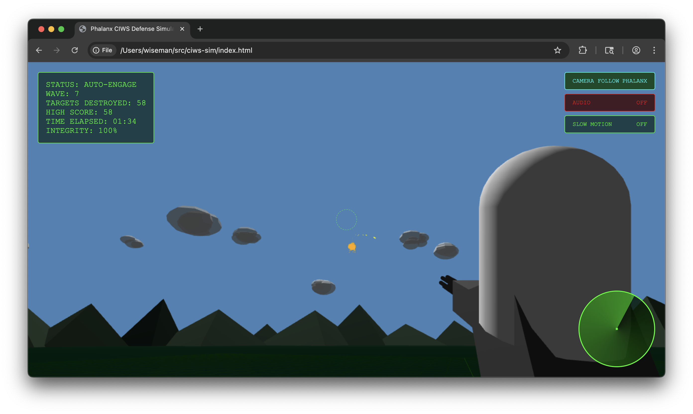

# Phalanx CIWS Defense Simulator

<div align="center">
  
</div>

<div align="center">
  <a href="https://ciws.obliscence.com">
    
  </a>
</div>

<br />

A vibecoded web-based simulation of the Phalanx CIWS (Close-In Weapon System) defense system.

## Running locally

It's a single `index.html` plus the voice clips in `sounds/`; serve the directory and open it:

```sh
python3 -m http.server 8000
```

Then open http://localhost:8000. Click or press a key to start the audio, and use the AUDIO button to unmute.

## Controls

| Key | Action |
| --- | --- |
| `C` | Cycle cameras: orbit, Phalanx, missile follow, split screen |
| `V` | Toggle the split-screen view (gunsight + chase camera) |
| `Z` | Zen mode: no UI, an endless battle and cinematic camera cuts (`Z` or `Esc` to leave) |
| `M` | Fire-control panel (classic solver / neural net) |
| `A` | Audio debug overlay |

The buttons at the top right switch the camera, audio, slow motion, spatial-audio mode and zen mode.

## Voice lines

The crew, CIC net and 1MC callouts are recorded clips in `sounds/`, generated and processed by
`tools/make_cic_audio.py`. Its `process` step also writes `sounds/callouts.json`, the list of clips
the game loads. How each line plays is set in the game's `BUCKETS` table; see
[docs/voice/README.md](docs/voice/README.md).

## Tools

The Python scripts in `tools/` (run with `uv run tools/<name>.py`) drive the game in headless
Chromium for screenshots, frame strips, audio captures, soak tests and the demo video.

## Deployment

To deploy to caprover:

```sh
tar cf deploy.tar captain-definition index.html sounds/*.mp3 sounds/callouts.json
```

Then upload the tar file to the caprover instance. The game needs `sounds/callouts.json` to find its
voice clips; without it, it runs silently.
