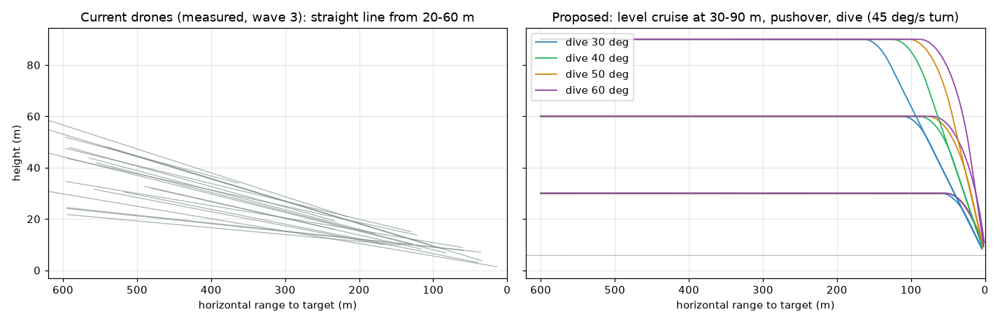

# Diving drones: plan

**The request:** "the drones should start out at maybe a 50% higher altitude than currently (with
some variation) and they should dive into their targets."

This is a plan only. No repo file was changed. Line numbers are from `index.html` as it was on
2026-10-16; another agent is editing that file (explosion debris momentum), so expect them to drift.
Function names are the stable references.

Scratch files in this folder:

| file | what it is |
|---|---|
| `drone_probe.py` | Playwright probe. It plays the game at a forced wave and logs each threat's spawn, height and speed against range, and how it ended. Read-only on the game. |
| `base-w3.json`, `base-w10.json` | Baseline probe runs (120 s each, waves 3 and 10). |
| `analyze.py` | Summarises probe JSON: spawn heights, height entering reach, kills and leaks, kill range and height. |
| `dive_sim.py`, `dive_sim.out` | Offline model in game units. It re-implements the classic solver, rounds, the hit test, radar noise and spread, and the proposed drone flight model. It gives the dive geometry, solver miss against time of flight, and Monte Carlo hit probability. |
| `profiles.png`, `profiles_plot.py` | Height against range: measured current drones beside the proposed profiles. |

---

## 1. How drones fly now

- **Spawn (`spawnMissile`, about line 5505):**
  - Half of the non-ASCM spawns are drones.
  - Horizontal distance is 600 at a random bearing.
  - Height is `20 + 40·rand` (uniform 20 to 60).
  - Velocity is a straight line at the target's point, at `MISSILE_SPEED_BASE + 0.05·wave` = `0.8 + 0.05·wave` u/step. That's 54 m/s at wave 2 (wave 2 starts on the first frame), 78 m/s at wave 10 and 108 m/s at wave 20.
  - The velocity is never changed after spawn.
- **Target (`pickTargetForIncoming` 5128, `targetInfoFor` 5135):**
  - It picks our ship or a random live friendly, 50/50.
  - Our ship's point is the **mount itself, (0, MOUNT_Y+2, 0) = (0, 6, 0)**. Drones do not use `shipStrikePoint`; only ASCMs do.
  - A friendly's point is its origin, `FRIENDLY_Y` = 0.75 (about the waterline).
- **Steering and orientation (`THREAT_TYPES.drone.steer`, 5371):** `m.mesh.lookAt(m.targetInfo.position)`. It only orients the mesh; the nose always points at the target.
- **Per-frame update (`updateLogic`, 7317):**
  1. `position += velocity·simSteps`.
  2. `steer(m)`, then spin the prop.
  3. `updateRadarTrack`.
  4. Impact if within 5 of the target point.
  5. ETA = straight-line distance / speed. This is used for target priority (earliest ETA first, friendlies on a tie).
- **Approach path:** a nearly level glide, from 1.3° to 5.6° below horizontal, so drones come in low over the water.

### Measured with `drone_probe.py` (current build)

| | wave 3 (120 s) | wave 10 (120 s) |
|---|---|---|
| drones | 20 | 25 |
| spawn height: min / median / mean / max | 21.9 / 43.0 / 40.5 / 59.2 | 20.1 / 40.3 / 38.3 / 57.1 |
| height entering the gun's reach (472 from the mount) | median 33.4 (18.5–47.1) | median 30.9 (16.5–46.1) |
| kill range from the mount: median (p10–p90) | 143 (54–254) | 124 (61–190) |
| kill height, median | 9.7 | 11.6 |
| drones leaked | 0 / 20 | 3 / 25 (all at friendlies) |
| mortars leaked / ASCMs leaked | 1/32, 0/15 | 2/34, 0/10 |

The wave-10 run ended early, at about 110 s. Five leaks reached friendlies (FRIENDLY_COUNT = 5), so all of them were sunk and the game ended in "friendlies lost".

**Most drones die late, 50–250 m from the mount and about 10 m up.** The gun is busy with other threats, mostly mortars, until they are close. A rough check suggests per-round hit probability is high once a drone is within about 150 m (see section 3), so leaks come from saturation, not accuracy. This matters because the proposed dive happens in exactly that last 50–170 m.

---

## 2. Proposed flight profile



### 2.1 Altitude

- **New spawn height: `30 + 60·rand` (uniform 30 to 90; mean and median 60).** This is the current distribution scaled by exactly 1.5×, so the spread scales too (±50% around the mean).
  - An alternative with fewer extremes is triangular 30–90, mode 60 (`30 + 30·(rand + rand)`). This is a decision for you.
- Spawn distance stays at 600. The elevation seen from the mount is 2–8° at spawn.
- **The drones hold altitude while cruising.** Today's drones descend the whole way.
  - So in the gun's engagement zone the new drones are about **1.9× higher** than now: a median of about 60 against about 32 entering reach.
  - At today's typical kill range (about 130 m) they are 30–90 m up instead of about 10 m.
  - This is the realistic shape for a one-way attack drone: cruise, then a terminal dive. It is also a bigger change than "1.5× altitude" alone suggests.
- **No wave scaling of altitude.**

### 2.2 The dive: a three-phase state machine for each drone

**CRUISE.**
- Level flight at the spawn height, heading for the target in plan, at the cruise speed `0.8 + 0.05·wave`. The cruise speed is unchanged.
- Optional weave (2.4).

**PUSHOVER.**
- It starts where a circular arc of radius `R = v / ω` (ω = the turn-rate limit) joins level flight to the dive line through the target point at the drone's dive angle γ.
- That gives the trigger, in horizontal range to the target:

  `x_p = Δh / tan γ + R · tan(γ/2)`, with Δh = height above the target point.

  Recompute it each step with the current speed. It is position-based, so it behaves the same in slow motion.
- During the pushover the velocity direction rotates toward the line of sight to the target point, by at most ω·simSteps per frame.
- From the moment of pushover the speed relaxes toward the dive speed (see TERMINAL).

**TERMINAL.**
- It switches to TERMINAL once the velocity is within 1° of the line of sight.
- Pure pursuit of the target point, with the same rate limit. For a stationary target this is a straight line, so after alignment the drone does not accelerate sideways.
- Speed relaxes toward `v_dive = v_cruise · (1 + DRONE_DIVE_SPEEDUP · sin γ)` with time constant τ: `speed += (v_dive − speed)·(1 − exp(−simSteps/τ))`. This represents gravity plus throttle.

**Recommended defaults.** All are in sim units: u/step, rad/step, and steps at 60 per second.

| constant | value | meaning |
|---|---|---|
| `DRONE_CRUISE_Y_MIN/MAX` | 30 / 90 | spawn height |
| `DRONE_DIVE_DEG` | 30–45° up to wave 3, widening to 35–60° by wave 10 | per-drone random dive angle |
| `DRONE_TURN_RATE` | 45°/s = 0.0131 rad/step | pitch and yaw rate limit: 4.3 g at 54 m/s |
| `DRONE_DIVE_SPEEDUP` | 0.6 | 45° dive: ×1.42 target speed |
| `DRONE_SPEEDUP_STEPS` | 42 (0.7 s) | speed-up time constant |
| `DRONE_DIVE_FIT` | clamp γ so `R(1 − cos γ) ≤ 0.6·Δh` | low drones can't fit a steep arc |

**Modelled geometry** (`dive_sim.py`, ship target y = 6, wave-2 speed 54 m/s):

| cruise h | dive γ | turn | pushover at (horizontal) | dive lasts | impact angle | impact speed | total flight |
|---|---|---|---|---|---|---|---|
| 30 | 30° | 40°/s | 62 m | 1.1 s | 31° | 64 m/s | 11.1 s |
| 45 | 40° | 40°/s | 74 m | 1.4 s | 41° | 69 m/s | 11.1 s |
| 60 | 40° | 40°/s | 92 m | 1.7 s | 41° | 71 m/s | 11.1 s |
| 60 | 50° | 60°/s | 69 m | 1.4 s | 51° | 73 m/s | 11.2 s |
| 75 | 40° | 60°/s | 101 m | 1.9 s | 40° | 73 m/s | 11.1 s |
| 90 | 30° | 40°/s | 166 m | 2.9 s | 30° | 70 m/s | 10.9 s |
| 90 | 50° | 40°/s | 106 m | 2.1 s | 52° | 76 m/s | 11.3 s |
| 30 | 50–60° | 40°/s | — | — | ~41° | — | arc doesn't fit (hence the γ clamp) |

What this means:

- With the geometric trigger, the impact angle comes within about 2° of the chosen γ whenever the arc fits.
- A simpler trigger, "push over when the target's depression angle reaches γ", was also modelled. Because of the turn lag it overshoots by 15–35° (for example, 60° chosen ended at 75–88°).
- Total flight time is within ±0.3 s of today's (about 11.1 s at wave 2), so spawn pacing and the demo video's "~7 s out" timing hold.
- **The dive is short: 1–3 s.** That is a direct result of 30–90 m of altitude at 54–110 m/s.
  - If you want a longer, more visible dive, the levers are a higher cruise height, shallower angles (30°), or a lower turn rate.
  - Higher waves are faster, so their dives are shorter still.

### 2.3 Aim points

**Our ship.**
- Keep the mount, (0, 6, 0). It's what "CIWS integrity" damage represents, and a dive from above clears the bridge (roof 8.5 at z 9–24).
  - Today's near-level approaches from astern fly through the bridge, funnels and hangar. A 30–40° dive from astern still grazes the thin tripod mast (top about 25 at z ≈ 21). That's only cosmetic.
- An option is a varied deck point near the mount: x within the hull half-width − 1, z within ±15, y = `deckHeightAt(z) + 1`. That gives varied damage-control calls (side and frame) instead of near-centreline every time. This is a decision for you.

**Friendlies.**
- Today the aim point is their origin at y 0.75. Use `f.position + (0, 2.5, 0)` (deck level) instead, so the 5-unit detonation radius goes off on the deck, not 3–4 m above the water beside it.

**Detonation.**
- Keep `distToTarget < 5`, but for drones test the **segment** from the previous to the new position, as the round hit test does.
- At 75–110 m/s a 15-step frame hitch is 19–27 units, which can jump straight through the 5-unit sphere. Pure pursuit would then turn the drone round in a loop.
- As a backstop, also detonate in TERMINAL if `y < target.y − 1`.

### 2.4 Optional weave or jink (cruise only)

- Heading = bearing to target + `A·sin(ω_w·age + φ)`, with A up to 8° and a period of 3–5 s random per drone. This is about ±5 m of lateral displacement at 54 m/s, and the turn rate stays well under the 45°/s limit.
- Fade A to 0 over the last 100 units before `x_p`, so the pushover starts wings-level.
- Wave-gated: off before wave 6, ramping to 8° by wave 12. This is a decision for you.
- This is the biggest lever on the classic solver's accuracy; see section 3.

### 2.5 Mesh pitch and bank

- **Replace `lookAt(target)` with an orientation built from the velocity.**
  1. Forward f = v̂.
  2. Right r = normalize(f × worldUp). When |f.y| > 0.98, reuse the previous r, because `lookAt` and `makeBasis` degenerate near vertical.
  3. Up u = r × f.
  4. Roll r and u about f by the bank angle.
  5. `Matrix4.makeBasis(x, u, f)` with x = u × f (the mesh's nose is +z), then `quaternion.setFromRotationMatrix`.
- The nose then sits level in cruise, pitches down smoothly through the pushover, and points along the dive.
- **Bank** = `atan(a_lat / g_vis)`. Here a_lat is the lateral acceleration (Δv ÷ simSteps, on r) and g_vis = 9.8 m/s² = 0.00272 u/step².
  - Low-pass it with `1 − exp(−simSteps/8)` and clamp it to ±60°.
  - The weave gives about 50° banks; the pushover is a vertical turn, so it gives no bank.
- Set the orientation at spawn too. Today's spawn code does `lookAt(targetPos)`.

---

## 3. Effect on the fire control

### 3.1 Analytic

The classic solver (`computeAimSolution`, 7177) extrapolates `trackedVelocity` at constant speed and adds `0.5·g·t²` of drop. The radar track (`updateRadarTrack`, 7219) is **true velocity + a slowly varying error**. It has no lag, so the only new error is that a turning or accelerating target is not where constant velocity predicts after the round's time of flight T:

`miss ≈ ½ · a · T²`, with T ≈ range / 8 steps.

- **Pushover:** a = v·ω.
  - At 54 m/s and 45°/s: 0.0118 u/step² (42 m/s²). The miss is 0.6 / 1.3 / 3.7 units at T = 10 / 15 / 25 steps (80 / 120 / 200 m).
  - At wave 10 (78 m/s): 0.85 / 1.9 / 5.3 units.
  - The hit radius is 1.0 unit.
  - The pushover happens at 60–170 m. It only hurts for high drones that push over early (h ≈ 90).
- **Speed-up:** the tangential acceleration is at most about 0.009 u/step², and it's along the line of sight for drones diving at the mount. It shows up mostly as a timing error, so it's smaller than the pushover.
- **Steady dive (TERMINAL):** zero acceleration, because pure pursuit of a stationary point is a straight line. The constant-velocity solver is exact again.
- **Weave:** a lateral acceleration of up to about 0.0033 u/step² for the whole cruise. It's 1.5 units off at T = 30, so it bites at long range.

### 3.2 Modelled (`dive_sim.py`)

**Noiseless miss distance.** Perfect track and no spread, so this isolates the dynamics.

| range from muzzle | current, h 40 | new, h 60, γ 40 | new, h 90, γ 40 | new + weave 8°/4 s |
|---|---|---|---|---|
| 350–472 (T ≈ 46) | 0.63 | 0.95 | 1.23 | 2.26 (1.60 with track comp) |
| 250–350 (T ≈ 34) | 0.39 | 0.65 | 0.84 | 1.41 (0.81) |
| 150–250 (T ≈ 23) | 0.23 | 0.46 | 0.60 | 0.70 (0.49) |
| 80–150, pushover | 0.13 | 0.25 | 0.55 (0.36 with comp) | 0.25 |
| 0–80, dive | 0.07 | 0.14 | 0.07 | 0.13 |

The level-flight misses at long range (0.63 and up) are already in today's solver. They come from how it handles gravity: it adds `0.5gt²` to the aim point after solving the intercept without gravity, while the rounds drop `g·n(n+1)/2`. That error grows with elevation, so **just flying higher costs some accuracy at long range**, with no dive involved. The plan leaves the solver as it is.

**Monte Carlo P(hit) per round.** This includes the radar noise model and gun spread. Wave 2 speed unless noted.

| range | current | new | new + accel comp | new + weave | weave + comp | current, w10 | new, w10 |
|---|---|---|---|---|---|---|---|
| 350–472 | 0.16 | 0.12 | 0.15 | 0.08 | 0.13 | 0.16 | 0.15 |
| 250–350 | 0.27 | 0.25 | 0.25 | 0.20 | 0.24 | 0.25 | 0.26 |
| 150–250 | 0.54 | 0.50 | 0.51 | 0.49 | 0.49 | 0.51 | 0.48 |
| 80–150 | 0.93 | 0.84 | 0.85 | 0.80 | 0.86 | 0.89 | **0.73** |
| 0–80 | 1.00 | 1.00 | 1.00 | 1.00 | 1.00 | 1.00 | 1.00 |

What this means:

- Per round, the dive costs a few points. The big drop is at 80–150 m at high waves, where the pushover happens at speed: 0.89 → 0.73.
- The gun fires 60 rounds a second and a drone takes 2 hits, so per-round accuracy is rarely what decides a kill.
- The larger gameplay effects are timing:
  - The dive's speed-up shortens the last 100 m by about 25%.
  - The higher altitude means the gun must pitch to 30–60° for close-in dives.
- These are model numbers. Section 5 measures the real effect in the game.

### 3.3 Options. The classic solver code is not touched in any of them.

- **A. Accept it as a gameplay trade-off.** Recommended for phase 1.
  - Diving and weaving drones are somewhat harder, which is realistic: maneuvering targets beat constant-velocity fire control.
  - Nothing changes for mortars or ASCMs.
- **B. A maneuver-aware track velocity for drones only. This is an additive change in `updateRadarTrack`.**
  - Keep a smoothed acceleration estimate â per drone. Low-pass the true Δv/simSteps with a lag of about 6–10 steps plus noise of about 10% of |â|, in the same "truth plus error" style as the existing model.
  - Then set `trackedVelocity += 0.5 · â · (range / BULLET_SPEED) · DRONE_TRACK_ACCEL_GAIN`.
  - The solver function and its behaviour for every other threat stay bit-for-bit the same. Gate it on a `THREAT_TYPES.drone.maneuverTrack` flag.
  - It recovers most of the weave's loss and about a third of the high-pushover miss.
  - The gain (0–1) is a difficulty knob.
  - This is a real-world idea: an alpha-beta-gamma or constant-acceleration Kalman tracker. The lag makes it imperfect at the onset of a maneuver, which is the realistic weakness.
- **C. A constant-acceleration solver.** Ruled out, because it changes the classic solver.
- **D. Make the pushover gentler** (a lower ω, or pushing over later). This trades away the look.

Note: B changes what the solver is *fed* for drones. Decide whether that still counts as "the classic solver fires exactly as now". It does for every threat type except the drones, which fly differently anyway.

### 3.4 The neural net

- **Inputs and spec are unchanged.**
  - The 7 inputs, `los-v1`, `7-32-24-3`, and the reach, speed and scale terms in `spec` are all the same.
  - `makeControllerInputs` takes the same `trackedVelocity` the solver gets. With option B, both see the same compensated velocity, so the teacher and the net stay consistent.
- **The saved model (`ciwsNeuralControllerV8`) still loads and is still correct in principle.** The teacher maps (D, V) → aim exactly as before, and only the distribution of V changes.
- **Distribution shift:**
  - Diving drones have more closing speed: up to about 0.46 in the closing input at wave 10 against about 0.33 for today's drones. ASCMs already reach about 0.65.
  - They also have sizeable vertical and sideways components while `isMortar` = −1, for dives at friendlies seen from the mount.
  - Verify with `tools/nn_diagnostics.py --frozen <saved net>` (aim error on drones) and a fresh learning run.
  - **Do not bump the storage key or spec.** Bump them only if an input is added (for example an acceleration feature: `los-v2`, `8-…`, `ciwsNeuralControllerV9`), which would discard saved models. That isn't recommended.
- **`isInReach` and `MAX_INTERCEPT_STEPS` are unaffected.**

---

## 4. Side effects

- **Radar tracking error (`updateRadarTrack`):** no change needed.
  - The position error scales with range from the origin, and altitude adds little.
  - The velocity error is 4% of |v|, so it grows by about 1.4× in the dive. That's fine, and slightly harder.
  - The 0.45 vertical scale gives a diving target smaller vertical errors. That's acceptable.
  - Option B, if chosen, is the only change, and it's drone-gated.
- **Target priority (`estimateTimeToImpact`):** straight-line distance ÷ current speed.
  - It slightly under-estimates a cruising drone's ETA, because the real path is level then down.
  - The dive speed-up then makes it accurate.
  - A diving drone's ETA drops quickly, so the gun swaps onto it. That is the desired behaviour; no change.
- **Threat Doppler voice (`updateThreats`, 2123):**
  - Doppler comes from `m.velocity`, so the speed-up already raises the pitch: for example a closing speed of 54 → 75 m/s, before the profile's exaggeration.
  - Add an **engine load** term: freq ×(1 + 0.25·load), where load = (speed − cruise)/(dive − cruise) is published on the threat as `m.engineLoad`, so audio doesn't read flight internals. This is the two-stroke engine wound up and the prop over-speeding in the dive.
  - Add an **air-rush noise band** to the drone voice, as the mortar has: `noiseBand(1400, 1.2, 0, out)`, with its level 0 → about 0.3 with load. It reads as a dive "whistle" without faking a jet.
  - Both are drone-only branches in the existing voice code; nothing is allocated per frame.
  - This is a decision for you: engine rise only, or rush as well.
- **Missile-follow camera (`updateCameraFollow`, mode 2):**
  - It sits 8 units back along drone→mount, plus 3 up, and looks at the mount.
  - For dives at our ship that becomes a bomb's-eye view down the dive line. It's good as it is.
  - For dives at a friendly it looks at the mount, not the dive, so the friendly can be out of frame.
  - Option: when the followed drone is in PUSHOVER or TERMINAL and its target is a friendly, offset back along −v̂ and blend the look-at toward `targetInfo.position`.
  - The existing per-frame lerp (0.2, not scaled for slow motion) trails a 75 m/s diver by about 8 more units. That's acceptable.
  - The kill camera already uses the threat's velocity, so it stays correct.
- **Gun camera (mode 1):** a drone diving at the mount comes in head-on and high, which is dramatic. There are no pitch limits in the code, and traverse rates are not limiting: 0.08 rad/step is about 275°/s.
- **Impacts on our ship:**
  - From above, the 5-unit detonation sphere puts the burst about 3.5 m above the mount at 45°. It looks like a hit on the mount.
  - `callDamageControl` takes side and frame from the burst point, so dives from the beam call port or starboard and dives from fore or aft call centreline.
  - `spawnImpact` already carries only the **horizontal** part of the velocity ("the hull takes the rest"), so a steep dive makes a near-symmetric burst. That's correct.
  - `isOverOpenWater` is unaffected.
- **Debris momentum** (the other agent's work, `FX_CARRY`):
  - Airbursts carry 0.7 of the threat's velocity in debris, capped at 110 u/s, **including the vertical part**.
  - A 75 m/s 45° diver killed over our ship throws debris down at about 37 m/s, plus FX gravity.
  - The debris has no collision with hulls, so it will **fall through our deck and the friendlies' decks**.
  - Ask the debris workstream for a deck kill plane: when `nearShip(p)` and `p.y < deckHeightAt(p.z)`, the debris ends with a spark puff instead of a water splash. Also do the same for friendly footprints. Kills at altitude just fall into the sea, which is fine.
- **Radar PPI (`updateRadar`):** plan view only, so nothing changes.
- **`tools/demo_video.py`:**
  - "New threats are ~7 s out" (wave 11) still holds, because the flight time changes by < 0.3 s.
  - The opening "early drones" shot from behind the mount: the line of fire now runs 8–10° higher. Check that the drones are still in frame.
  - The missile-follow segment (10–13.5 s) follows whatever is the target. It may now show a dive.
  - The late-wave overview may now show drones diving onto friendlies, which is a plus.
  - No code change is expected. Re-render and review.
- **`tools/soak.py`:** it counts only ASCMs. Extend it (section 6).
- **Merge risk:** the debris agent is editing `updateLogic`'s explosion call sites and `createExplosion`. The drone work touches `spawnMissile`, `THREAT_TYPES.drone`, the threat loop in `updateLogic` (the `steer` call and the impact test), `updateRadarTrack` (option B only), the audio voice and the camera. Land it after their change, or rebase carefully around `updateLogic`.

---

## 5. Implementation outline

### Constants

Put these next to the ASCM block, around line 659.

```js
// Delta-wing drones: cruise level at altitude, then push over into a dive at their target
const DRONE_CRUISE_Y_MIN = 30, DRONE_CRUISE_Y_MAX = 90;   // 1.5x the old 20-60
const DRONE_DIVE_DEG_EARLY = [30, 45], DRONE_DIVE_DEG_LATE = [35, 60], DRONE_DIVE_RAMP_WAVES = [3, 10];
const DRONE_TURN_RATE = THREE.MathUtils.degToRad(45) / SIM_STEPS_PER_SECOND; // rad/step
const DRONE_DIVE_SPEEDUP = 0.6;     // dive speed = cruise * (1 + this * sin(dive angle))
const DRONE_SPEEDUP_STEPS = 42;     // its time constant (0.7 s)
const DRONE_ALIGN_RAD = THREE.MathUtils.degToRad(1);
const DRONE_WEAVE_FIRST_WAVE = 6, DRONE_WEAVE_FULL_WAVE = 12, DRONE_WEAVE_MAX_DEG = 8;
const DRONE_BANK_MAX = THREE.MathUtils.degToRad(60);
const DRONE_BANK_G = 9.8 / (SIM_STEPS_PER_SECOND * SIM_STEPS_PER_SECOND); // u/step^2
const DRONE_FRIENDLY_AIM_Y = 2.5;   // above a friendly's origin: her deck
```

### Code

1. **`spawnDrone(targetInfo, opts = {})`.** Extract it from `spawnMissile`'s drone branch.
   - Set the height and position, and adjust the friendly aim point.
   - Pick γ from the wave-lerped range, then clamp it to fit.
   - Set the horizontal velocity at the cruise speed.
   - Call `addThreat(...)`, then attach `m.dive = { phase: 0, cruise, speed, gamma, tanHalf, weaveA, weaveW, weavePhase, age: 0, bank: 0, right: new Vector3() }`. That is the only allocation, made once per drone.
   - Call `orientDrone(m, 0)`.
   - `opts` takes angle, height, gamma, weave and targetIndex for tools.
   - `spawnMissile` calls it.
2. **`updateDiveDrone(m, simSteps)` becomes `THREAT_TYPES.drone.steer`.**
   - Change the call in `updateLogic` from `steer(m)` to `steer(m, simSteps)`. The ASCM and mortar steers ignore the extra argument.
   - Each frame (the move has already happened):
     1. Compute the vector to the target and the horizontal range.
     2. If in CRUISE, build the desired direction from the bearing plus the weave. Switch to PUSHOVER when `horiz ≤ Δh/tan γ + (speed/DRONE_TURN_RATE)·tanHalf`.
     3. If in PUSHOVER or TERMINAL, the desired direction is the line of sight. Relax the speed. Go to TERMINAL when the angle to the line of sight is under `DRONE_ALIGN_RAD`.
     4. Rotate `m.velocity`'s direction toward the desired direction by `min(angle, DRONE_TURN_RATE·simSteps)` using `Vector3.applyAxisAngle`. That uses three.js's internal scratch quaternion, so nothing is allocated.
     5. Set the length to the speed.
     6. Set `m.engineLoad`.
     7. Call `orientDrone`.
   - Use module-scope scratch objects (`_droneTo`, `_droneDesired`, `_droneAxis`, `_droneBasis` (Matrix4), `_droneQuat`), as `_ascmLook` and `_tmpDir` do.
3. **`orientDrone(m, simSteps)`:** the basis, bank and fallback described in 2.5.
4. **The impact test in `updateLogic`:**
   - For drones, test the closest approach of the segment from the previous to the new position to the target point (`Ray.distanceSqToPoint`, or a segment helper with scratch vectors).
   - Also detonate in TERMINAL if `y < target.y − 1`.
   - Keep the mortar and ASCM tests as they are.
5. **Audio:** the drone branch in `createThreatVoice` gets the rush band, and `updateThreats` reads `m.engineLoad`.
6. **Camera:** an optional friendly-dive framing tweak in mode 2.
7. **Option B** (if chosen): a drone-gated acceleration estimate in `updateRadarTrack`.
8. **Debug hook:** `window.__ciws.debug.spawnDrone({ angle, height, gamma, weave, targetIndex, invulnerable })`, returning the threat. `invulnerable` sets `health = Infinity` so strips can watch a full dive.

### Units and slow motion

- Everything in the drone code scales by `simSteps`: turn = rate·simSteps, the speed and bank filters use `1 − exp(−simSteps/τ)`, and the weave phase += ω·simSteps. The pushover trigger is position-based.
- At 0.1× slow motion (simSteps ≈ 0.1 per frame) the arc is identical, just finer.
- If simSteps > 2 (a hitch, or a slow machine), loop the guidance and move in chunks of ≤ 1 step for drones. That means moving the drone's own move into `updateDiveDrone`, behind a type flag, so the arc's shape doesn't depend on frame rate.
- Never use `realDt` or divide by `timeScale`.
- No per-frame allocations in the new code.

---

## 6. Verification

1. **Probe** (`drone_probe.py`, promoted to `tools/dive_probe.py`):
   - Log height, speed and `m.dive.phase` against range for each drone, plus the impact angle.
   - Plot the results with `profiles_plot.py`.
   - Accept when:
     - spawn heights lie within [30, 90] with a mean of about 60;
     - the impact angle is within ±3° of γ for h ≥ 45;
     - the turn rate never exceeds 45°/s, computed from samples;
     - speed rises ×1.3–1.45;
     - nothing is NaN;
     - there are no loop-backs (the range to target is monotonic).
2. **Frame strips:**
   - Add a `dive` scenario to `tools/scene_shot.py`: `debug.spawnDrone({ invulnerable: true, angle, height: 90, gamma: 45 })` aimed at our ship, with the camera abeam about 120 m off the dive line on a long lens, and frames every 0.25 s from pushover to impact.
   - Add a `dive-friendly` scenario with the same setup aimed at friendly 0.
   - Run each again at `setTimeScale(0.1)` to check the arc is smooth and the nose follows it.
   - Add a weave scenario from above to check the banking.
3. **Soak A/B:**
   - Extend `tools/soak.py` to tally every type (killed or leaked by type and target), the drones' kill range and height, and the phase at kill.
   - Run 5 × 120 s at waves 3, 6 and 10 on the old build (a saved snapshot of `index.html` served by `_harness` with a `--page` option) and on the new one.
   - Report leaks per 100 drones and friendlies lost.
   - Variance is high: the baseline had 0/20 and 3/25 leaks. Five runs give about 125 drones per cell, enough to see a change of about 5 points.
   - Optional: seed `Math.random` with `page.add_init_script` to reduce variance.
4. **Fire control:**
   - Read `engagementStats` hits per round from the soak, classic only, before and after.
   - Use `tools/nn_diagnostics.py --frozen` with a net saved before the change, plus a fresh learning run, then `--neural` soak.
5. **Audio:** `tools/voice_capture.py` / `audio_capture.py` on a scripted dive, listening for the Doppler rise, the engine load and the rush.
6. **Demo:** re-render `tools/demo_video.py` and review it.

---

## 7. Phases

1. **Flight model.**
   - Altitude, cruise, pushover, terminal and orientation.
   - The segment impact test.
   - The friendly aim point.
   - The debug hook.
   - Verify with probe and strips.
   - No weave, and no fire-control change.
2. **Feel:** engine load and rush audio, and the camera tweak.
3. **Balance:**
   - Soak A/B and dive-angle wave scaling.
   - Then decide on weave and option B from the measured leak rates.
4. **Tooling and demo:** the soak per-type tallies, the dive scenarios, the demo re-check, and NN diagnostics.

## 8. Risks

- **`lookAt` or basis degeneracy near vertical dives:** use the right-vector fallback, and keep γ ≤ 60° by default.
- **Fly-through or loop-back on frame hitches:** use the segment test and substeps.
- **Low drones can't fit steep dives:** clamp γ.
- **The dive is short (1–3 s):** it may read as "suddenly drops". Tune γ and the turn rate after seeing strips.
- **Altitude makes long-range shots worse through today's gravity handling:** this is an existing solver property, flagged rather than fixed.
- **Higher-wave drones dive faster, so the pushover-phase P(hit) falls (modelled 0.89 → 0.73 at 80–150 m):** the leak rate may rise at waves 10 and above. Measure it before adding weave.
- **Debris falls through decks** after the momentum work: coordinate a deck kill plane.
- **Merge conflicts with the debris workstream in `updateLogic`.**

## 9. Decisions for you

1. **Altitude distribution:** uniform 30–90 (exactly 1.5× today's 20–60), or triangular 30–90 peaking at 60.
2. **Dive angle:** 30–45° early, widening to 35–60° by wave 10 (recommended), or a fixed range, or some near-vertical "Lancet-style" 70–80° divers. The steep ones need the near-vertical orientation fallback and a higher turn rate.
3. **Dive speed-up:** about ×1.4 at 45° (recommended), smaller, or none.
4. **Weave or jink:** off, late waves only (from wave 6, up to 8°), or always.
5. **Fire control:** accept the trade-off (A), or add the drone-only maneuver-aware track velocity (B) with a gain. Also, does B count as "the classic solver unchanged"?
6. **Our ship's aim point:** keep the mount, or vary it over the deck near the mount for varied damage-control calls and burst positions.
7. **Missile camera:** keep looking at the mount, or frame dives at friendlies along the dive.
8. **Dive sound:** engine and prop pitch rise only, or an air-rush "whistle" as well.
9. **Debris through decks:** ask the debris agent to add a deck kill plane.
